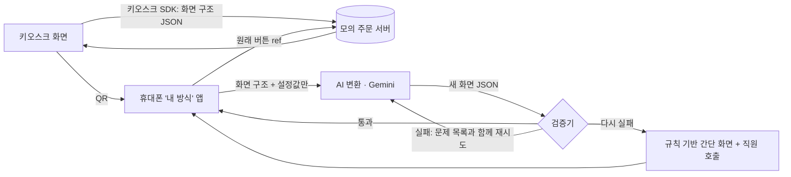

# 내 방식 QR — 키오스크를 내 휴대폰에서, 내 방식으로

2026 AI 라이프 솔루션 챌린지 출품 시제품. 「AI 라이프 아이디어 챌린지」 수상 후보작 **5번 「내 방식 QR – 범용 접근성 프로필 패스」**를 구현했습니다.

키오스크 화면 구석의 QR을 휴대폰으로 찍으면, AI가 **지금 그 키오스크 화면**을 사용자가 정한 방식(큰 글씨·큰 버튼·쉬운 말·단계 설명·읽어 주기·고대비·5개 언어)으로 **실시간** 다시 만들어 휴대폰에 보여 줍니다. 휴대폰에서 누른 버튼은 원래 키오스크의 버튼 값 그대로 주문 시스템에 전달되어, 키오스크 화면도 함께 바뀝니다.

## 구조



| 단계 | 하는 일 | 파일 |
|---|---|---|
| 키오스크 SDK | 원래 화면(메뉴·옵션·장바구니·결제·완료)을 구조 데이터로 내보냄 | `shared/screens.ts` |
| 내 방식 설정 | 언어·글씨·버튼·말·설명·읽어 주기·고대비. 휴대폰에만 저장, 장애 유형·이름은 받지 않음 | `src/pages/Setup.tsx`, `shared/profile.ts` |
| AI 변환 | 화면 구조 + 설정 → 새 화면. 버튼 ref는 원래 화면의 값으로만 고를 수 있게 enum으로 묶음(제약 출력) | `server/prompt.ts`, `server/ai.ts` |
| 검증 | 아래 표의 규칙. hard 위반이면 쓰지 않고 재시도/대체 | `shared/validate.ts` |
| 대체 화면 | AI 실패·한도 초과 시 매장 데이터만으로 만든 큰 화면 | `shared/fallback.ts` |
| 렌더링 | 글씨 크기·터치 영역·열 수·한 화면 항목 수는 코드로 강제 (우선순위: 글씨 > 버튼 > 설명, 넘치면 '더 보기') | `src/pages/Me.tsx` |
| 모의 주문 서버 | 키오스크와 휴대폰이 같은 상태 기계를 공유, 30분 뒤 자동 삭제 | `shared/reducer.ts`, `api/*.ts` |

### 검증 규칙

| 코드 | 수준 | 내용 |
|---|---|---|
| `E_SCHEMA` | hard | 출력 구조가 깨짐 |
| `E_MISSING_REF` / `E_UNKNOWN_REF` / `E_DUP_REF` | hard | 원래 버튼이 빠짐 / 없는 버튼을 만듦 / 같은 버튼이 두 번 |
| `E_PRICE_TEXT` | hard | AI가 가격을 글로 씀 (가격은 매장 데이터에서 표시) |
| `E_ALLERGEN` | hard | 매장 데이터에 없는 알레르기 성분을 '들어 있다'고 씀 (ko/en 자동 검사) |
| `E_LANG` | hard | 설정한 언어가 아님 (번역 뒤 괄호 속 한국어 원래 이름은 허용) |
| `E_PLACEHOLDER` | hard | 주문번호 자리표시자 `{orderNo}`가 빠짐 |
| `S_COLUMNS` / `S_PAGE` | soft | 열 수·한 화면 항목 수 제한 초과 (렌더러가 보정) |
| `S_LABEL_LONG` / `S_HINT_LONG` | soft | 쉬운 말·설명 길이 제한 초과 |
| `S_HINT_MISSING` / `S_SPEECH_MISSING` | soft | 단계 설명·읽어 주기 문장 누락 |

## 측정

- `/eval`: (매장 2 × 화면 5 × 대표 프로필 6 × 반복) 조합을 **캐시 없이** 실제 AI로 변환하고, 첫 시도 통과율·재시도 포함 통과율·대체 비율·변환 시간(중앙값/95%)·문제 코드를 기록합니다. JSON/CSV로 저장할 수 있습니다. AI가 실제 Gemini가 아니면 경고가 뜹니다.
- `/kiosk?test=1`: 원래 키오스크 화면 주문과 QR로 연 '내 방식' 주문의 걸린 시간·누른 횟수·정정 횟수를 익명으로 기록합니다(개인정보 없음). `/eval` 아래쪽에서 볼 수 있습니다.

## 실행

```bash
npm install
AI_PROVIDER=mock npm run dev      # AI 없이 화면 흐름만 확인 (mock 결과는 측정·보고에 쓰지 않음)
GEMINI_API_KEY=... npm run dev    # 실제 Gemini로 실행
npm test                          # 상태 기계·검증기·변환 파이프라인 단위 테스트
npm run build
```

### 배포 (Vercel)

1. Vercel에서 이 저장소를 Import
2. Environment Variables: `GEMINI_API_KEY` (Google AI Studio 무료 키). 선택: `EVAL_KEY`(측정 페이지 암호), `AI_DAILY_LIMIT`(기본 300), `GEMINI_MODEL`
3. Storage → Upstash Redis(무료) 연결 → `KV_REST_API_URL`/`KV_REST_API_TOKEN`이 자동으로 들어옴
4. 배포 후 `/api/health`에서 `provider: gemini`, `storage: redis` 확인

## 밝혀 두는 것

- 매장·메뉴·가격·알레르기 정보는 시연용 예시입니다. 결제는 모의 결제입니다.
- 서비스 안의 AI는 Google Gemini API(화면 변환, 말로 설정하기)입니다. 무료 등급은 입력이 서비스 개선에 쓰일 수 있어, 개인정보를 보내지 않도록 설계했습니다(화면 구조와 설정값만 전송).
- 개발에는 AI 코딩 도구(Anthropic Claude)를 사용했습니다(코드 작성·자동 테스트 보조). 아이디어 선택·설계 승인·실기기 테스트·제출은 참가자가 했습니다.
- 아이디어: 2026 AI 라이프 아이디어 챌린지 수상 후보작 5번. 사전질의 답변(양방향 중 '키오스크 QR → 휴대폰' 우선, 실시간 AI 변환, 터치 보정 = 버튼 확대, 우선순위 글씨 > 버튼 > 설명, 모의 결제 서버 허용, 변환 성공률 중시)을 설계에 반영했습니다.
